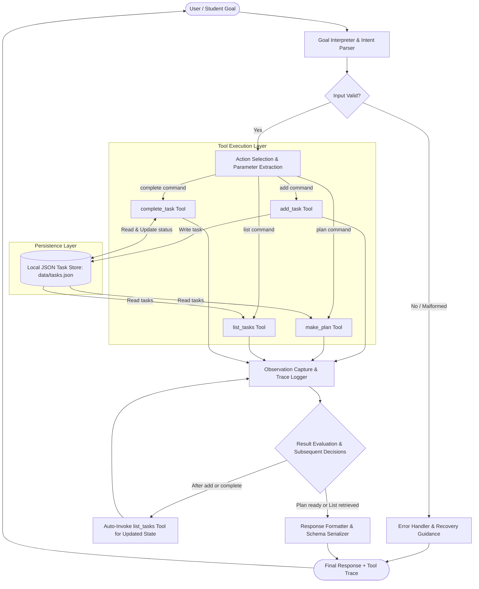

# System Architecture & Agent Design

The **Agentic Study Assistant** is a deterministic, rule-based autonomous task planner designed for student productivity. It demonstrates an observable **Plan → Act → Observe → Evaluate** architectural lifecycle with zero external API dependencies.

---

## 1. Architecture Diagram

The system architecture diagram below illustrates the complete lifecycle from the user's goal through goal interpretation, input validation, action selection, tool execution, persistent state updates, observation capture, and result evaluation to the final structured response.

---

## 2. Core Architectural Components

### 2.1 User Goal
The entry point of the system. Students provide natural-language requests via interactive CLI REPL or direct terminal arguments (e.g., `"add Revise DBMS for 45 minutes priority high due 2026-10-25"`, `"plan 120 minutes"`, `"list tasks"`, or `"complete 1"`).

### 2.2 Goal Interpreter & Input Validation
A deterministic, rule-based routing engine that maps unstructured student text into structured intents and validated arguments.
- **Duration Validation**: Rejects zero or negative study durations (`minutes > 0`).
- **Priority Whitelisting**: Normalizes and checks priorities (`high`, `medium`, `low`).
- **Deadline Parsing**: Validates ISO 8601 calendar dates (`YYYY-MM-DD`).
- **Error Pathway**: If validation fails or the goal is malformed, the error path is triggered immediately, returning actionable recovery advice without executing corrupted operations.

### 2.3 Action Selection & Tool Execution Layer
The agent selects and invokes modular Python functions based on the identified intent:
1. `add_task(title, minutes, priority, due_date)`: Validates, appends, and writes the task to persistent storage.
2. `make_plan(available_minutes)`: Extracts pending tasks, sorts by priority, deadline, and duration, and packs tasks into the time window.
3. `list_tasks()`: Formats current tasks into a readable status list.
4. `complete_task(identifier)`: Matches tasks by 1-based index or title substring and marks them as `done`.

### 2.4 Persistence Layer (`data/tasks.json`)
- Stores task records as serialized JSON.
- Implements resilient error handling for missing files, empty files, or corrupted records, preventing application crashes.

### 2.5 Observation Capture & Trace Logger
Every tool call is intercepted by `_act()`, which records:
- `tool`: Name of the executed tool.
- `observation`: String representation of the tool output.

Traces are isolated per request, ensuring clean verification of individual turns.

### 2.6 Result Evaluation & Subsequent Decisions
The agent does not stop at a single action. When modifying persistent state (e.g., adding or completing a task):
1. The tool execution result is captured as an observation.
2. The agent evaluates the outcome and automatically triggers `list_tasks` to inspect the updated system state.
3. Both actions and their observations are appended to the request trace.

### 2.7 Final Response & Schema Serializer
Formats both human-readable terminal output and structured JSON payloads conforming to `schema.json`.

---

## 3. Plan → Act → Observe → Evaluate Cycle

| Stage | Operation | Agent Implementation |
|---|---|---|
| **Plan** | Reason about goal, parse tokens, validate inputs, select tool | `StudyAgent._parse_*` and intent routing |
| **Act** | Execute tool function with validated arguments | `StudyAgent._act(tool_name, tool_fn, *args)` |
| **Observe** | Record output string into structured trace | `self.trace.append({"tool": ..., "observation": ...})` |
| **Evaluate** | Inspect observation, make subsequent tool calls if needed | Triggers `list_tasks` after mutation; checks plan fit |
| **Respond** | Return terminal text and schema-compliant JSON | `StudyAgent.execute()` and `StudyAgent.run()` |

---

## 4. Design Note: Rule-Based vs. LLM Integration

This project uses **rule-based intent routing** rather than a Large Language Model (LLM). This is an intentional educational design decision for the assignment:
- **Zero API Dependencies**: Runs completely offline without OpenAI/Anthropic/Google API keys or billing.
- **Predictable & Verifiable**: Guarantees deterministic test results and reproducible grading demonstrations.
- **Architectural Extensibility**: The `Goal Interpreter` can be upgraded to an LLM router (e.g., via LangChain or Gemini SDK) in the future without altering the underlying tool contracts, persistence layer, or `schema.json`.
